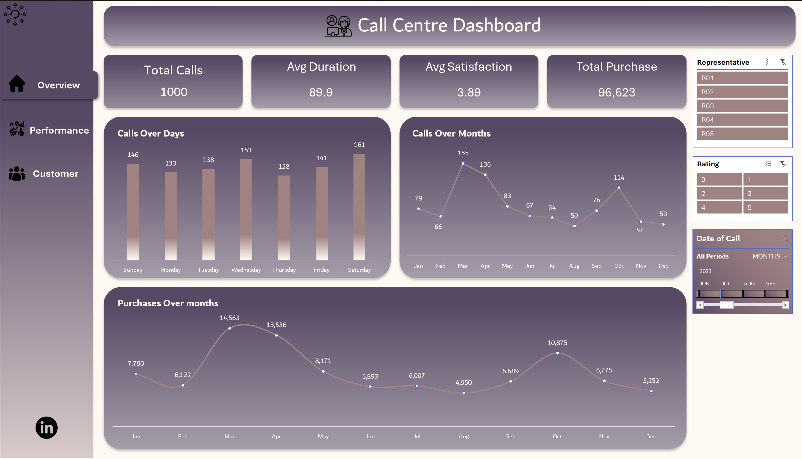
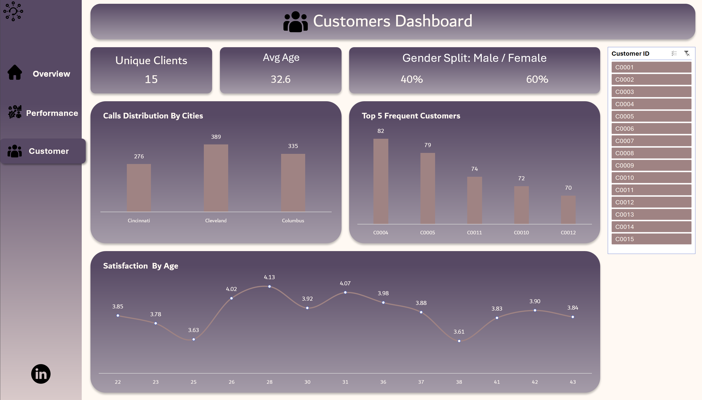

# Call Centre Performance Dashboard (Excel)

An interactive Excel dashboard that looks at one year of call centre activity: how many calls come in, when they come in, how long they last, how happy customers are, and which agents and cities stand out.

I built this to practise the full Excel workflow end to end: cleaning, modelling, pivot tables and dashboard design. It is a portfolio project on a sample dataset, so the numbers show how I work, not a real company.

## Dashboard preview

| Overview | Agent Performance | Customers |
|---|---|---|
|  |  |  |

## Questions I wanted to answer

1. How many calls came in, and when are the busy periods (day of week, month)?
2. How long do calls last, and does a longer call mean a happier customer?
3. Which agents handle the most calls, bring the most purchases, and get the best ratings?
4. Do customers in different cities behave differently?
5. Who are the most frequent callers?

## Key findings

- **1,000 calls** in 2023, with an average duration of **89.9 minutes** and an average satisfaction of **3.89 / 5**. Total purchase amount was **96,623**.
- **March is the peak month** (155 calls, 14,563 in purchases). August is the quietest (50 calls).
- **Saturday is the busiest day** (161 calls) and Thursday the quietest (128).
- **Call length does not drive satisfaction.** The correlation between duration and rating is about 0.01, so longer calls are not better or worse rated. Over 76% of calls last more than an hour, which would be the first thing to look at in a real operation.
- **Agents are close on quality, different on volume.** Ratings only range from 3.86 (R03) to 3.92 (R01). R02 takes the most calls (218), while R03 brings in the highest purchase amount (20,872). R04 has the longest average calls (95.7 min) and the lowest purchase amount (16,651).
- **Cleveland generates the most calls** (389, about 39%), but **Cincinnati is the happiest city** (4.03 average rating) and Columbus the lowest (3.77).

## How it is built

| Sheet | What it does |
|---|---|
| `Data` | Two tables: `calls` (1,000 rows) and `customers` (15 rows). Calculated columns: Fiscal Year, Day of week, Duration Bucket, Rating rounded, plus City, Age and Gender pulled in with `XLOOKUP`. |
| `Meta data` | Data dictionary: every column, its type, and the business questions it helps answer. |
| `Pivot` | 14 pivot tables that feed every KPI and chart. |
| `OverView`, `Performance`, `Customer` | The three dashboard pages, with navigation buttons between them. |

**Tools and techniques:** Power Query, Data Model (Power Pivot), PivotTables and PivotCharts, slicers and a timeline, `XLOOKUP`, `IFS`, named ranges, custom dashboard layout with linked KPI cards.

## Assumptions and limitations

- `Duration` is treated as **minutes** (the duration buckets only make sense that way). Average calls of around 90 minutes are unrealistic for a real call centre, which is a sign this is sample data.
- Fiscal year runs **July to June**.
- Only **15 customers** make all 1,000 calls (about 67 calls each), so the customer page is useful for showing the technique, but I would not draw real conclusions about customer behaviour from it.
- The data has no currency, so purchase amounts are shown as plain numbers.

## What I would add next

- A SQL version of the same analysis, to compare it with the pivot-based approach.
- A Power BI version of the dashboard.

## Files

- `Call_Center_Dashboard.xlsx`: the full workbook (open in desktop Excel; slicers and timeline need Excel 2013 or later).
- `Overview.png`, `Performance.png`, `Customers.png`: dashboard screenshots.

## Data

Sample call centre dataset from Kaggle: [dataset name and link].

## Author

**Moataz Khamiss**, Applied Data Analytics and Visualization student at Sheridan College
[LinkedIn](https://www.linkedin.com/in/moataz-khamiss-070698247/)
